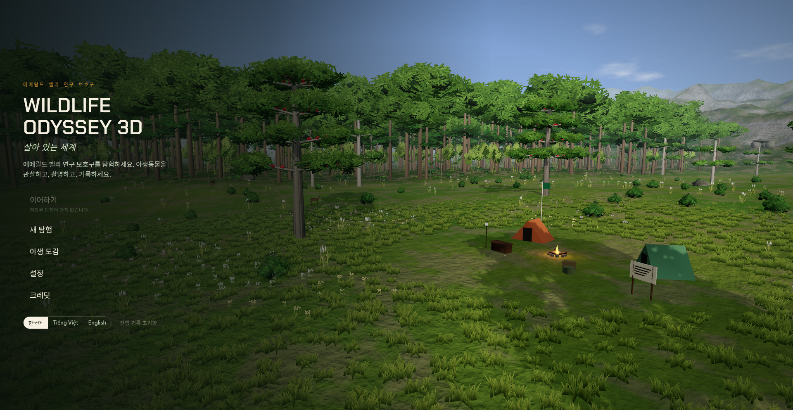
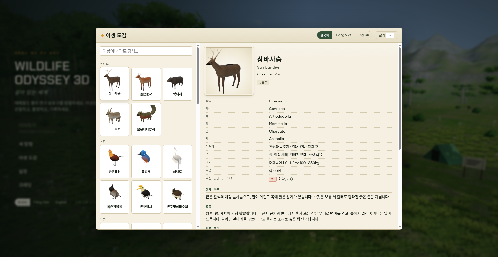
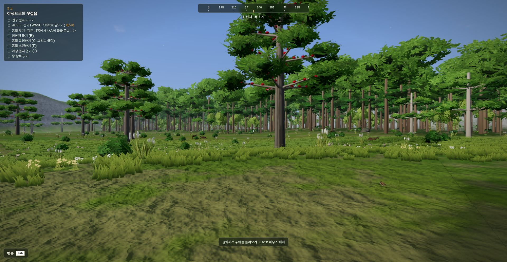
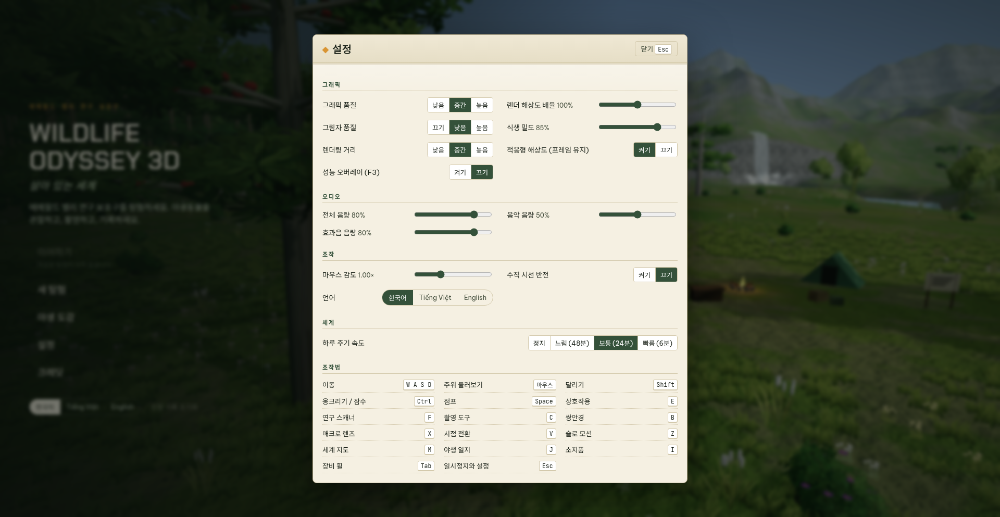

# Wildlife Odyssey 3D — 살아 있는 세계 (한국어판)

    

브라우저에서 바로 실행되는 3D 야생 탐험·과학 관찰 게임입니다. 에메랄드 밸리 연구 보호구를 탐험하면서 동남아시아의 실제 동식물 36종을 관찰하고, 사진과 영상으로 기록하고, 야생 일지를 채워 보세요. 이 저장소는 [quanap5/wildlife-odyssey-3d](https://github.com/quanap5/wildlife-odyssey-3d)(MIT 라이선스)의 한국어판입니다. 한국어, 베트남어, 영어를 지원합니다.

**플레이:** https://sigco3111.github.io/wildlife-odyssey-3d-ko/

지형, 식물, 동물, 텍스처, 사운드까지 보이고 들리는 모든 것이 실행 시점에 절차적으로 생성됩니다. 외부 모델·텍스처·오디오 파일이 없고 서버도 필요 없습니다.

## 실행 화면









## 주요 기능

- **오픈 월드 탐험**: 초원, 열대 우림, 강과 호수, 산과 폭포, 고대 유적의 다섯 생태계를 걸어서(그리고 헤엄쳐서) 탐험
- **야생 사진 촬영**: 줌, 초점 잠금, 노출, 심도를 조절해 촬영. 사진은 7개 기준으로 채점되고 촬영한 종이 식별됨
- **생물 스캐너와 야생 일지**: 종을 스캔해 식별하면 분류, 서식지, 먹이, 보전 등급(IUCN)이 담긴 도감 항목이 열림
- **영상 녹화**: 행동을 녹화하고 슬로 모션으로 다시 보기
- **연구 역할과 탐험 임무**: 야생동물 생물학자 또는 고고학자로 시작해 5개의 탐험 임무와 배지 완성
- **3D 과학 관찰**: 매크로 렌즈로 작은 생물을 확대하고 부위별 해부학 노트 확인
- **저장**: IndexedDB에 탐험 진행 상황, 사진, 영상 저장 (서버 없이 브라우저 안에서)

## 설치와 실행

Node.js 20.19 이상(또는 22.12 이상)이 필요합니다.

```bash
npm install
npm run dev        # http://127.0.0.1:5173
```

프로덕션 빌드 (`dist/`에 정적 파일 생성, `base: './'`라 어떤 경로에서도 서빙 가능):

```bash
npm run build
npm run preview    # http://127.0.0.1:4173
```

배포는 `dist/`를 아무 정적 호스트에나 복사하면 됩니다. 서버 코드나 환경 변수가 필요 없습니다.

검사:

```bash
npm run lint       # ESLint
npm run test       # Vitest 단위 테스트 (153개)
npm run test:e2e   # Playwright 브라우저 테스트 (Chrome 필요)
```

## 기술 노트

- **스택**: React 19 + TypeScript(strict) + Vite 8, Three.js + React Three Fiber + Drei, Zustand(상태), Rapier(WASM 물리), Web Audio API(합성 사운드), IndexedDB(저장)
- **한국어화**: 기존 베트남어/영어 이중언어 구조(`src/i18n/`, 종 도감 JSON)에 한국어를 제3언어로 추가. UI 문자열 전체와 36종 도감(이름·설명·행동·적응·생태 역할·흥미로운 사실 등)을 번역했고, 언어 키 일치·플레이스홀더 일치를 단위 테스트로 검증합니다. 기본 언어는 한국어이며 설정에서 변경 가능합니다.
- **한국어 폰트**: Noto Sans KR(OFL 1.1)을 한국어판에서 실제 사용하는 글리프만 서브셋으로 만들어 번들(약 132KB). 기존 Chakra Petch / Be Vietnam Pro / JetBrains Mono(OFL)와 함께 `src/fonts.css`에 선언되어 있습니다.
- **배포**: `gh-pages` 브랜치에 빌드 산출물을 올려 GitHub Pages로 서빙합니다.

## 라이선스와 크레딧

- **원작**: [quanap5/wildlife-odyssey-3d](https://github.com/quanap5/wildlife-odyssey-3d) by quanap5, MIT License (원문: `LICENSE`)
- 이 한국어판도 동일한 MIT License를 따릅니다.
- 번들 폰트(Chakra Petch, Be Vietnam Pro, JetBrains Mono, Noto Sans KR)는 SIL Open Font License 1.1이며 전문은 `public/licenses/FONTS-OFL.txt`에 있습니다. 에셋 라이선스 정리는 `docs/asset-licenses.md` 참고.
- 종 정보 출처와 검증 내역은 각 종 도감 페이지와 `docs/species-sources.md`에 있습니다.
- 원작의 개발 문서(영문): `docs/` (아키텍처, 게임 디자인, 구현 상태 등). 원본 README는 `docs/README-original.md`에 보존되어 있습니다.
